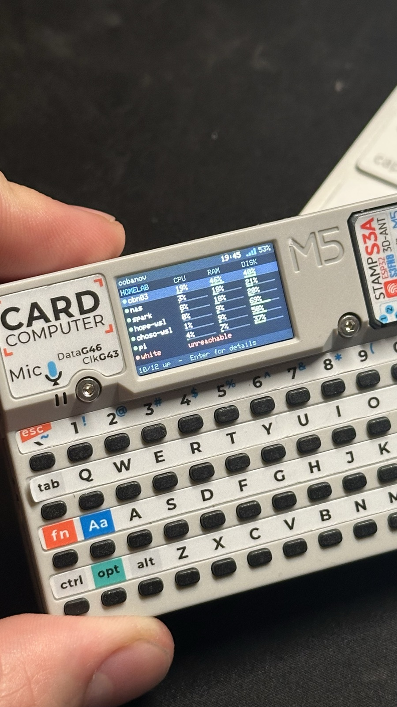
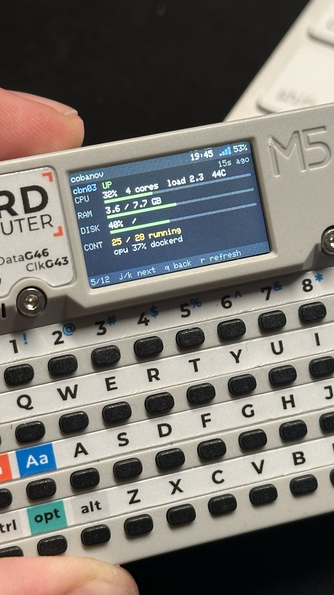

# cardputer-homelab

A pocket homelab panel for the [M5Stack Cardputer](https://docs.m5stack.com/en/core/Cardputer). Every machine you can SSH into, on a 240×135 screen with a real keyboard: is it up, how busy is it, which disk is filling, what is the GPU doing.

<p>
  
  
</p>

## Features

- **Host list**: up/down dot, CPU, RAM and fullest disk for every machine, with colored bars (green under 75%, yellow to 90%, red above)
- **Host detail**: cores, load and temperature; RAM in GB; the fullest mount; GPU model, utilization and VRAM; running vs total containers; what the machine is busy with right now
- **Agentless**: nothing is installed on the monitored machines; data comes from [fleet](https://github.com/cobanov/fleet) over SSH
- **Safe summary**: the server passes on only the fields the panel shows; raw fleet output holds process command lines, which can contain tokens, so it never leaves the server
- **Hands-off Wi-Fi**: joins the strongest known network in the background and reconnects on its own, without freezing the UI
- **No flicker**: each frame is drawn off-screen and pushed in one go
- Clock with NTP sync and switchable time zones, battery level, Wi-Fi signal

## How it works

```
Cardputer  ──Wi-Fi──▶  fleet-panel (server/fleet-panel.py)  ──ssh──▶  every machine
  GET /panel every 15 s    runs `fleet --json` every 15 s
                           serves a ~2 KB summary
```

## Hardware

M5Stack Cardputer v1.1 (StampS3A, ESP32-S3FN8, 8 MB flash, no PSRAM). The ADV model should work too, but it is untested.

## Setup

### 1. Server

Install and configure [fleet](https://github.com/cobanov/fleet) on a machine that can SSH into your hosts (`fleet setup`), then:

```sh
python3 server/fleet-panel.py      # serves GET /panel on :8791 (set PORT to change)
curl localhost:8791/panel          # check
```

On macOS, `server/dev.cobanov.fleet-panel.plist` keeps it running as a LaunchAgent. Edit the paths in it, copy it to `~/Library/LaunchAgents/` and run `launchctl bootstrap gui/$(id -u) <plist>`.

### 2. Firmware

Needs [PlatformIO](https://platformio.org/).

```sh
cp include/secrets.example.h include/secrets.h   # list your Wi-Fi networks
# set PANEL_URL in src/main.cpp to the server's address
pio run -t upload
```

`include/secrets.h` is git-ignored.

If the Cardputer still runs UiFlow and does not show up for flashing, switch it off, hold `G0` and plug in USB. The battery keeps it running, so replugging alone does not reset it.

## Keys

| Key | Action |
|---|---|
| `j` `k` or `;` `.` | select machine |
| `Enter`, `1`–`9` | details |
| `q`, `` ` ``, `del` | back |
| `r` | refresh now (auto every 15 s) |
| `t` | sync clock (NTP) |
| `z` | change time zone |
| `i` | help |
| `x` | restart |

## Notes

- The server has no auth. Keep it on a trusted LAN; the panel only works on that network.
- The built-in font is ASCII only; the server replaces the few non-ASCII characters fleet uses.
- Windows hosts are not supported by fleet yet; monitor their WSL side instead.

## License

[MIT](LICENSE)
